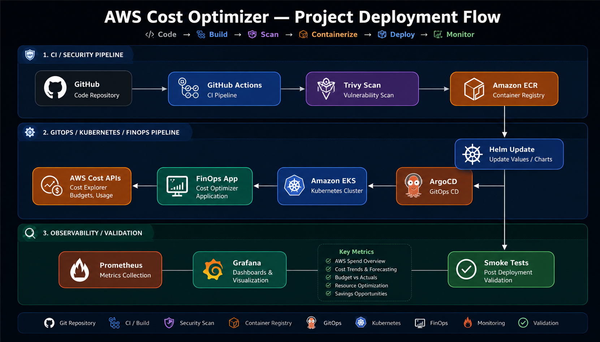

# 🚀 Multi-Account AWS FinOps SaaS Platform

<div align="center">


**Production-grade, multi-tenant AWS FinOps automation and governance platform.**

### 🌐 [Live Demo →](https://aws-cost-optimizer-nw25-two.vercel.app/)

</div>

---

## 🎯 What Is This?

Not just a cost dashboard. A complete **FinOps automation platform** implementing the full cycle:

```
OBSERVE → DETECT → ANALYZE → RECOMMEND → SIMULATE → APPROVE → REMEDIATE → VERIFY → AUDIT
```

Users sign up, connect any number of AWS accounts via secure cross-account IAM roles, and get:
real-time cost analysis, AI-powered recommendations, one-click remediation with audit trails,
security posture scoring, and a Claude AI Copilot that answers questions using real account data.

---

## 🏗️ Architecture

```
┌─────────────────────────────────────────────────────────────────────┐
│                         Users (Multi-Tenant)                        │
└─────────────────────┬───────────────────────────────────────────────┘
                      │
                      ▼
┌─────────────────────────────────────────────────────────────────────┐
│              React Frontend (Vercel) — 15 pages                     │
│  Login │ Dashboard │ Accounts │ Recommendations │ Remediation │ ...  │
└─────────────────────┬───────────────────────────────────────────────┘
                      │ JWT (Bearer)
                      ▼
┌─────────────────────────────────────────────────────────────────────┐
│              FastAPI Backend (AWS EKS)                              │
│  ┌─────────────┐ ┌──────────────┐ ┌─────────────────────────────┐  │
│  │   Cognito   │ │  PostgreSQL  │ │     FinOps Engine           │  │
│  │   Auth      │ │  Multi-tenant│ │  Recommendations + Security  │  │
│  └─────────────┘ └──────────────┘ └─────────────────────────────┘  │
└─────────────────────┬───────────────────────────────────────────────┘
                      │ STS AssumeRole + ExternalId
                      ▼
┌─────────────────────────────────────────────────────────────────────┐
│              User's AWS Accounts (Cross-Account)                    │
│  Account A          Account B          Account C                    │
│  EC2/S3/RDS/Lambda  EC2/S3/RDS/Lambda  EC2/S3/RDS/Lambda           │
└─────────────────────────────────────────────────────────────────────┘
```
### 🚀 Project Deployment Flow:



## 🚀 Core FinOps & DevOps Stack

<p align="center">
  
  
  
  
  
  
</p>

<p align="center">
  <strong>AWS • Terraform • Docker • Kubernetes • GitHub Actions • Helm</strong>
</p>

---

## 🔐 Security & DevSecOps

<p align="center">
  
</p>

<p align="center">
  <strong> • Trivy</strong>
</p>

---

## ☸️ Kubernetes & Cloud

<table align="center">
  <tr>
    <td align="center">
      
    </td>
    <td align="center">
      
    </td>
    <td align="center">
      
    </td>
    <td align="center">
      
    </td>
  </tr>
</table>

<p align="center">
  <strong>Amazon EKS • Helm • ArgoCD • Amazon ECR</strong>
</p>


## 💰 FinOps & AWS Cost Intelligence

<table align="center">
  <tr>
    <td align="center">
      
    </td>
  </tr>
</table>

<p align="center">
  <strong>AWS Cost Explorer • AWS Budgets • AWS Resource APIs • Boto3</strong>
</p>


## 📊 Monitoring & Observability

<p align="center">
  
  
</p>

<p align="center">
  <strong>Prometheus • Grafana • Kubernetes Metrics • Application Monitoring</strong>
</p>


## ⚙️ Application Stack

<p align="center">
  
  
  
  
</p>

<p align="center">
  <strong>Python • FastAPI • React • JavaScript • REST APIs</strong>
</p>
---

## ✨ Features

| Phase | Feature | Highlight |
|-------|---------|-----------|
| 1 | **Multi-user Auth** | Cognito + JWT RS256 + PostgreSQL |
| 2 | **Multi-Account** | STS AssumeRole + ExternalId (confused-deputy prevention) |
| 3 | **AWS APIs** | EC2, S3, RDS, Lambda, EKS, Cost Explorer — all account-aware |
| 4 | **Recommendations** | 8 types, confidence scores, savings estimates |
| 5 | **Remediation** | Dry-run + approval + complete audit trail |
| 6 | **Security Center** | IAM, S3, SG checks + security score (0-100) |
| 6 | **AI Copilot** | Claude AI with real AWS data context |
| 7 | **Tests** | pytest with mocked AWS — auth, IDOR, recommendations, remediation |

---

## 🛠️ Tech Stack

| Layer | Technology |
|-------|-----------|
| **Frontend** | React, JSX, Tailwind CSS, Recharts, Vercel |
| **Backend** | Python 3.11, FastAPI, SQLAlchemy, boto3 |
| **Auth** | Amazon Cognito, JWT (RS256 verification) |
| **Database** | PostgreSQL (multi-tenant, SQLAlchemy ORM) |
| **Cloud** | AWS EKS, ECR, STS, IAM, Cost Explorer, EC2, S3, RDS, Lambda |
| **AI** | Claude (Anthropic API) |
| **DevOps** | Docker, Kubernetes, Helm, Terraform, GitHub Actions, ArgoCD |
| **Monitoring** | Prometheus, Grafana, AlertManager |
| **Testing** | pytest, pytest-cov, httpx, unittest.mock |

---

## 🏗️ High-Level Architecture

```text
                         ┌───────────────────┐
                         │      Developer    │
                         └─────────┬─────────┘
                                   │ git push
                                   ▼
                         ┌───────────────────┐
                         │   GitHub Actions  │
                         │                   │
                         │  Build            │
                         │  Trivy Scan       │
                         │  Push to ECR      │
                         │  Update Helm      │
                         └─────────┬─────────┘
                                   │
                                   ▼
                         ┌───────────────────┐
                         │     Amazon ECR     │
                         │  backend/frontend  │
                         └─────────┬─────────┘
                                   │ image
                                   ▼
                         ┌───────────────────┐
                         │      ArgoCD       │
                         │   GitOps Sync     │
                         └─────────┬─────────┘
                                   │
                                   ▼
              ┌────────────────────────────────────┐
              │          Amazon EKS Cluster         │
              │                                    │
              │  ┌────────────┐  ┌──────────────┐ │
              │  │ React/Nginx│  │   FastAPI    │ │
              │  │  Frontend  │  │   Backend    │ │
              │  └────────────┘  └──────┬───────┘ │
              │                         │         │
              │                       AWS APIs    │
              └────────────────────────┼─────────┘
                                       │
                 ┌─────────────────────┼─────────────────────┐
                 │                     │                     │
                 ▼                     ▼                     ▼
        ┌────────────────┐   ┌────────────────┐   ┌────────────────┐
        │ AWS Cost       │   │ AWS Budgets    │   │ AWS Resources  │
        │ Explorer       │   │                │   │ APIs           │
        └────────────────┘   └────────────────┘   └────────────────┘

                 ┌────────────────────────────────────┐
                 │ Prometheus + Grafana               │
                 │ Monitoring / Dashboards / Metrics  │
                 └────────────────────────────────────┘
```
## 🔄 End-to-End Delivery Flow

```text
Developer
   │
   ▼
GitHub
   │
   ▼
GitHub Actions
   │
   ├── Build Backend Image
   ├── Build Frontend Image
   ├── Trivy Security Scan
   ├── Push Images → Amazon ECR
   │
   ▼
Update Helm image tags
   │
   ▼
Git commit / push
   │
   ▼
ArgoCD
   │
   ├── Refresh Application
   ├── Auto-Sync
   └── Wait for Healthy State
   │
   ▼
Amazon EKS
   │
   ▼
AWS ALB
   │
   ▼
FinOps Dashboard + API
   │
   ▼
Smoke Tests ✅
```

---

## 🔐 Security Pipeline

The CI pipeline adds security validation before application images are promoted.

```text
Docker Build
     │
     ▼
Trivy Image Scan
     │
     ├── Backend: CRITICAL findings can fail the pipeline
     │
     └── Frontend: HIGH / CRITICAL findings exported as SARIF
     │
     ▼
Amazon ECR
```

---

## 📊 FinOps Data Flow

The backend uses AWS SDK (`boto3`) to query AWS Cost Explorer and AWS Budgets.

```text
                         ┌─────────────────────┐
                         │   AWS Cost Explorer │
                         └──────────┬──────────┘
                                    │
              ┌─────────────────────┼─────────────────────┐
              │                     │                     │
              ▼                     ▼                     ▼
        MTD Spend             Service Spend          Daily Trend
              │                     │                     │
              └─────────────────────┼─────────────────────┘
                                    │
                                    ▼
                         ┌─────────────────────┐
                         │   FastAPI Backend   │
                         └──────────┬──────────┘
                                    │
                         ┌──────────┴──────────┐
                         │                     │
                         ▼                     ▼
                 React Dashboard       Optimization APIs

                         ┌─────────────────────┐
                         │     AWS Budgets     │
                         └──────────┬──────────┘
                                    │
                                    ▼
                         Budget / Forecast Status
```


## 📁 Project Structure

```
aws-cost-optimizer/
├── backend/
│   ├── app/
│   │   ├── auth/
│   │   │   ├── cognito.py          # Signup/login/logout/verify
│   │   │   └── dependencies.py     # JWT verification + FastAPI dep
│   │   ├── database/
│   │   │   ├── database.py         # PostgreSQL + SQLAlchemy
│   │   │   └── models.py           # Users, AWSAccounts, AuditLogs...
│   │   ├── routers/
│   │   │   ├── auth.py             # /auth/*
│   │   │   ├── accounts.py         # /accounts/*
│   │   │   ├── resources.py        # /resources/* (account-aware)
│   │   │   ├── recommendations.py  # /recommendations/*
│   │   │   ├── remediation.py      # /remediation/*
│   │   │   ├── audit.py            # /audit/*
│   │   │   ├── security.py         # /security/*
│   │   │   └── copilot.py          # /copilot/*
│   │   └── services/
│   │       ├── aws_assume_role.py      # STS AssumeRole + ExternalId
│   │       ├── aws_client_factory.py   # Account-aware boto3 sessions
│   │       ├── account_dependency.py   # FastAPI dependency + ownership
│   │       ├── ec2_service.py          # EC2, EBS, EIP
│   │       ├── s3_service.py           # S3 buckets
│   │       ├── rds_service.py          # RDS instances
│   │       ├── cost_service.py         # Cost Explorer
│   │       ├── lambda_eks_service.py   # Lambda + EKS
│   │       ├── recommendation_service.py # Recommendation engine
│   │       ├── remediation_service.py  # Stop/delete/release actions
│   │       ├── audit_service.py        # Audit log queries
│   │       ├── security_service.py     # IAM/S3/SG security checks
│   │       └── copilot_service.py      # Claude AI copilot
│   └── tests/
│       ├── conftest.py
│       ├── test_auth.py
│       ├── test_accounts.py
│       ├── test_recommendations_remediation.py
│       └── test_security_audit.py
├── frontend/
│   └── src/
│       ├── context/
│       │   ├── AuthContext.jsx     # Auth state
│       │   └── AccountContext.jsx  # Account state
│       ├── hooks/
│       │   └── useAccountApi.js    # Account-aware API calls
│       ├── pages/
│       │   ├── auth/Login.jsx
│       │   ├── auth/Signup.jsx
│       │   ├── Overview.jsx
│       │   ├── Accounts.jsx
│       │   ├── Recommendations.jsx
│       │   ├── Remediation.jsx
│       │   ├── AuditLogs.jsx
│       │   ├── SecurityCenter.jsx
│       │   └── AICopilot.jsx
│       └── components/ui/
│           ├── Sidebar.jsx
│           ├── AccountSelector.jsx
│           └── NoAccountBanner.jsx
├── k8s/helm/values.yaml
├── terraform/
├── .github/workflows/cicd.yml
└── .env.example
```
## 📸 Screenshots
### 🖥️ Application Dashboard


### ⚙️ GitHub Actions CI/CD Pipeline


### 🚀 ArgoCD GitOps Deployment


## 📊 Monitoring & Observability

- **Prometheus** for real-time metrics collection
- **Grafana** dashboards for Kubernetes and application monitoring
- Monitored **CPU, memory, pods, nodes, and resource utilization**
- Implemented **alerting and health monitoring**
- Enabled observability for **performance tracking and FinOps optimization**


---

## 🚀 Quick Start

### Prerequisites
```bash
aws, python 3.11+, node 18+, docker, kubectl, helm
```

### Local Development

```bash
# 1. Clone
git clone https://github.com/Ujjwal0022/aws-cost-optimizer.git
cd aws-cost-optimizer

# 2. Configure environment
cp .env.example .env
# Edit .env with your Cognito + PostgreSQL + Anthropic values

# 3. Start PostgreSQL
docker run -d --name finops-db \
  -e POSTGRES_USER=finops \
  -e POSTGRES_PASSWORD=finops123 \
  -e POSTGRES_DB=finops_db \
  -p 5432:5432 postgres:15

# 4. Backend
cd backend
pip install -r requirements.txt
uvicorn app.main:app --reload --port 8000

# 5. Frontend
cd frontend
npm install
VITE_API_URL=http://localhost:8000 npm run dev
```

Open: http://localhost:5173

---

## ☁️ AWS Setup

###  Configure AWS Credentials

```bash
aws configure
# AWS Access Key ID:     YOUR_KEY
# AWS Secret Access Key: YOUR_SECRET
# Default region:        us-east-1
# Output format:         json
```

---

###  Provision Infrastructure (Terraform)

```bash
cd terraform
terraform init
terraform plan
terraform apply    # ~15 minutes
cd ..
```

**Creates:**
- ✅ VPC (public + private subnets)
- ✅ EKS Cluster `finops-eks` — 2x t3.medium nodes
- ✅ ECR Repository `finops-app`
- ✅ IAM Roles for EKS + nodes
- ✅ AWS ALB Ingress Controller

---

###  Connect to EKS

```bash
aws eks update-kubeconfig --region us-east-1 --name finops-eks
kubectl get nodes    # Should show Ready
```

---

###  Install ArgoCD + Prometheus + Grafana

```bash
# ArgoCD
kubectl create namespace argocd
kubectl apply -n argocd -f https://raw.githubusercontent.com/argoproj/argo-cd/stable/manifests/install.yaml
kubectl rollout status deploy/argocd-server -n argocd

# Get ArgoCD Password
kubectl get secret argocd-initial-admin-secret -n argocd \
  -o jsonpath="{.data.password}" | base64 -d

# Prometheus + Grafana
helm repo add prometheus-community https://prometheus-community.github.io/helm-charts
helm repo update
helm upgrade --install prometheus prometheus-community/kube-prometheus-stack \
  --namespace monitoring --create-namespace --wait
```

---

###  Add GitHub Secrets

Go to: `GitHub Repo → Settings → Secrets → Actions → New secret`

| Secret | Value |
|--------|-------|
| `AWS_ACCESS_KEY_ID` | Your AWS access key |
| `AWS_SECRET_ACCESS_KEY` | Your AWS secret key |
| `AWS_REGION` | `us-east-1` |
| `ECR_REGISTRY` | `ACCOUNT.dkr.ecr.us-east-1.amazonaws.com` |
| `ARGOCD_SERVER` | ArgoCD LoadBalancer URL |
| `ARGOCD_PASSWORD` | From Step 5 output |

---

###  Build & Push Docker Image to ECR

```bash
# ECR Login
aws ecr get-login-password --region us-east-1 | docker login \
  --username AWS \
  --password-stdin YOUR_ACCOUNT_ID.dkr.ecr.us-east-1.amazonaws.com

# Build & Push Frontend
docker build -t YOUR_ACCOUNT_ID.dkr.ecr.us-east-1.amazonaws.com/finops-app:latest ./frontend
docker push YOUR_ACCOUNT_ID.dkr.ecr.us-east-1.amazonaws.com/finops-app:latest

# Build & Push Backend
docker build -t YOUR_ACCOUNT_ID.dkr.ecr.us-east-1.amazonaws.com/finops-backend:latest ./backend
docker push YOUR_ACCOUNT_ID.dkr.ecr.us-east-1.amazonaws.com/finops-backend:latest
```

---

###  Deploy with Helm

```bash
helm install finops helm/finops/ \
  --namespace finops \
  --create-namespace \
  --set image.repository=YOUR_ACCOUNT_ID.dkr.ecr.us-east-1.amazonaws.com/finops-app \
  --set image.tag=latest
```

---

###  Apply ArgoCD App (GitOps)

```bash
kubectl apply -f argocd/project.yaml
kubectl apply -f argocd/application.yaml
```

ArgoCD will now **auto-sync** on every `git push origin main` 🔄

---

###  Push & Trigger CI/CD

```bash
git add .
git commit -m "deploy: initial setup"
git push origin main
```

**GitHub Actions pipeline runs automatically:**

---

###  Verify Deployment

```bash
# Check pods
kubectl get pods -n finops
kubectl get pods -n monitoring

# Check services
kubectl get svc -n finops

# Get ALB URL
kubectl get ingress -n finops
```

---

### Access Services

| Service | URL |
|---------|-----|
| FinOps Dashboard | `http://<ALB-DNS>/` |
| API Docs | `http://<ALB-DNS>/api/docs` |
| ArgoCD | `https://<ARGOCD-LB>/` |
| Grafana | `http://<ALB-DNS>/grafana` (admin/prom-operator) |
| Prometheus | `http://<ALB-DNS>/prometheus` |

---

### 🧹 Cleanup

```bash
# Delete Kubernetes resources
helm uninstall finops -n finops
helm uninstall prometheus -n monitoring
kubectl delete namespace argocd finops monitoring

# Destroy AWS infrastructure (saves cost)
cd terraform
terraform destroy
```

###  User's IAM Role (FinOpsReadOnlyRole)

Users create this in **their** AWS account:

```bash
# Trust policy
{
  "Version": "2012-10-17",
  "Statement": [{
    "Effect": "Allow",
    "Principal": {"AWS": "arn:aws:iam::PLATFORM_ACCOUNT_ID:root"},
    "Action": "sts:AssumeRole",
    "Condition": {
      "StringEquals": {"sts:ExternalId": "finops-GENERATED-EXTERNAL-ID"}
    }
  }]
}
```

Attach: `ReadOnlyAccess` policy (or custom `FinOpsReadOnlyPolicy.json`)

---
## 🧪 Testing

```bash
cd backend

# Run all tests
pytest tests/ -v

# With coverage report
pytest tests/ --cov=app --cov-report=term-missing

# Specific test file
pytest tests/test_accounts.py -v

# Specific test
pytest tests/test_recommendations_remediation.py::TestRemediationService::test_stop_ec2_dry_run -v
```

**Test coverage includes:**
- ✅ Authentication (signup, login, wrong password, unconfirmed)
- ✅ Account ownership / IDOR prevention
- ✅ STS AssumeRole + ExternalId validation
- ✅ Recommendation engine (EC2, EBS, EIP, RDS)
- ✅ Remediation dry-run + execution + failed action logging
- ✅ Security checks (IAM, S3, Security Groups)
- ✅ Audit log filtering + stats

---

## 🔐 Security Model

| Protection | Implementation |
|-----------|---------------|
| **No credentials stored** | STS AssumeRole per request, 1-hour TTL |
| **Confused-deputy attack** | ExternalId on every AssumeRole call |
| **JWT verification** | Cognito JWKS public key (RS256) |
| **IDOR prevention** | DB ownership check on every account query |
| **Dry-run by default** | Remediation requires explicit `dry_run: false` |
| **Audit trail** | Every action logged: user, resource, status, savings |
| **Secrets management** | Kubernetes Secrets, never in Git |

---

## 📊 API Reference

Full interactive docs: `http://localhost:8000/docs`

```
Authentication:     POST /auth/signup  /auth/login  /auth/me
AWS Accounts:       GET/POST /accounts/  POST /accounts/{id}/test
Resources:          GET /resources/ec2  /ebs  /s3  /rds  /waste  /costs
Recommendations:    GET /recommendations/  /summary
Remediation:        POST /remediation/stop-ec2  /delete-ebs  /release-eip
Audit:              GET /audit/  /audit/stats
Security:           GET /security/report  /score  /iam  /s3
Enterprise:         GET /enterprise/anomalies  /forecast  /score  /regions
```


## 📬 Contact

**Ujjwal Kumar**
- 📧 ujjwal.kumararvind910@gmail.com
- 📱 +91-8368327428
- 🎓 B.Tech CSE, MAIT (GGSIPU) Delhi — 2027 Batch
- 💼 [GitHub](https://github.com/Ujjwal0022) | [Live Demo](https://aws-cost-optimizer-nw25-b6k0x8v7e.vercel.app/)


<div align="center">
<i>Built to demonstrate production-grade Cloud Engineering, DevOps, and FinOps expertise.</i>
</div>
